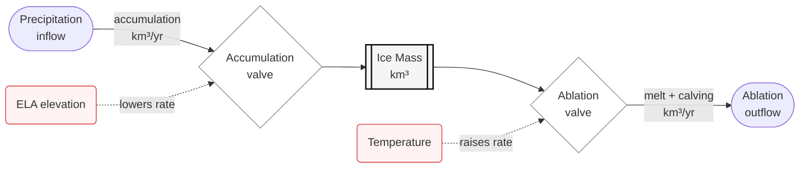
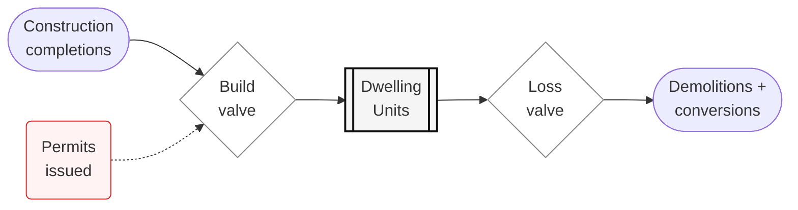
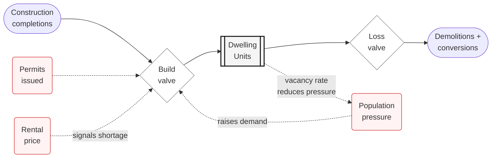

# Chapter 01 Production Plan: "What Is a System?"

**Status at plan date:** 2026-04-05  
**For agents:** Writer, Simulation Engineer, Diagram Specifier  
**What exists:** Full prose for all sections. Exercises written. Math correct.  
**What this plan specifies:** The three production gaps only — simulation, diagrams, cross-link callouts.

---

## Simulation Spec

**System:** Glacier ice mass (Earth systems domain).

Rationale: the glacier is the primary example threaded through the chapter (it appears in the opening section, in the stock-flow diagram illustration, in the boundaries section, and in Exercise 1.2). The simulation closes the loop on Exercise 1.2 by showing what the student computed analytically.

### Parameters

```
S0       = 50.0        # initial ice mass, km³
acc      = 1.2         # accumulation (inflow), km³/year — constant in base scenario
abl_base = 1.2         # ablation (outflow), km³/year — base scenario (balanced)
dt       = 1.0         # time step, years (Euler method — no scipy needed)
T        = 120         # simulation duration, years
```

Three scenarios to run in a single figure:
1. **Balanced** — `acc = 1.2`, `abl = 1.2` (stock holds steady)
2. **Accumulation dominant** — `acc = 1.5`, `abl = 1.2` (stock grows, glacier advances)
3. **Ablation dominant** — `acc = 1.2`, `abl = 1.45` (stock declines; at these values the glacier disappears around year 200, but the 120-year window shows clear depletion — this is the scenario that matches the Exercise 1.2 numbers)

### What the simulation must demonstrate

1. The stock is the integral of the net flow, not the flow itself — a constant excess outflow produces a straight-line decline, not a sudden drop. Students should feel this viscerally.
2. Response time = stock / net outflow rate. At 50 km³ and a net loss of 0.25 km³/year (scenario 3), disappearance is ~200 years out, but the trend is already clear at 30 years. This is the Chapter 1 central claim about delays.
3. Identical structure, different parameter values → qualitatively different long-run behaviour.

### Code specification

- **Method:** Euler integration only. No `scipy.integrate`. The update rule `S[i+1] = S[i] + (acc - abl) * dt` should be visible and commented.
- **Length:** 35–45 lines including comments and plot code.
- **Libraries:** `numpy`, `matplotlib.pyplot` only.
- **Structure:**
  1. Define parameters as named constants at the top (easy to modify).
  2. A single loop over time steps for each scenario, storing stock values in a pre-allocated array.
  3. Plot all three scenarios on one axis.
  4. Horizontal dashed line at `S = 0` (extinction threshold).
  5. A short docstring or header comment explaining what the simulation represents.

### Plot specification

- **X-axis:** Time (years), 0 to 120
- **Y-axis:** Ice mass (km³), 0 to 75 (leave headroom above S0 for growth scenario)
- **Three lines:**
  - Balanced: `#888888`, solid, label "Balanced (acc = abl = 1.2 km³/yr)"
  - Accumulation dominant: `#d52a2a`, solid, label "Advancing (acc = 1.5 km³/yr)"
  - Ablation dominant: `#111111`, solid, label "Retreating (abl = 1.45 km³/yr)"
- **Horizontal reference:** dashed line at y = 0, colour `#888888`, linewidth 0.8, label "Glacier disappears"
- **Title:** "Glacier ice mass under three flow scenarios"
- **Legend:** upper left
- **No gridlines.** Spine: left and bottom only (remove top and right).

### Placement in chapter

Insert as a new section immediately after "Three examples: the same structure in different domains" and before "What a stock-flow analysis tells you". Title the section:

```markdown
## Simulating the glacier: seeing stocks and flows in motion
```

Open with two sentences of prose (written by Writer agent, not specified here) that link the simulation back to Exercise 1.2 and invite the student to run it before reading on. Then the code block. Then the "What to try" block below.

### "What to try" section

Insert as a Quarto callout immediately after the code block:

```markdown
::: {.callout-tip}
## What to try

1. **Change the ablation rate to 1.6 km³/year.** How many years before the glacier disappears? Does the response time formula (stock ÷ net outflow) give you the right answer?

2. **Make accumulation a function of time** — replace the constant `acc` with `acc = 1.2 - 0.005 * t` to simulate a slow decline in snowfall. What changes in the shape of the stock curve? At what point does the decline accelerate?

3. **Start with a larger stock (S0 = 200 km³)** but keep the same flows. How does response time change? What does this tell you about large ice sheets versus small mountain glaciers?
:::
```

---

## Diagram Specs

### Diagram 1: Glacier stock-flow diagram (replaces ASCII placeholder)

**Placement:** Replace the ASCII block in the "Drawing the system: stock-flow diagrams" section entirely.

**Format:** Mermaid `flowchart LR` diagram.

**Notation conventions:**
- Stocks: rectangle nodes with double borders — use `[[Ice Mass\n(km³)]]`
- Flows: directional arrows with a valve label — represent the valve/tap as a diamond node `{Ablation\nvalve}`
- Auxiliaries: rounded rectangle `(Temperature)`
- Information connections: dashed arrows `-.->` 
- Material flow arrows: solid `-->`

**Exact diagram spec:**



**Caption to follow the diagram:**

> Figure 1.1. Glacier ice mass as a stock-flow system. Rectangles are stocks (accumulations). Diamonds are valves (flow regulators). Rounded rectangles are auxiliaries (variables that control flow rates). Dashed arrows carry information; solid arrows carry material flows. Temperature acts only through information — it does not flow into the glacier; it changes the rate at which ice leaves it.

---

### Diagram 2: Housing system — narrow and wide boundary versions (for Exercise 1.3 reference)

**Placement:** Insert as a new exhibit block immediately after Exercise 1.3 text (before Exercise 1.4). Label it "Figure 1.2."

**Purpose:** Give students a worked example of boundary drawing before they attempt the exercise themselves. Show the same core stock in two boundary configurations.

**Format:** Two Mermaid `flowchart LR` diagrams, side by side using a Quarto column layout:

```
::: {layout-ncol=2}
[Narrow diagram]

[Wide diagram]
:::
```

**Narrow boundary diagram spec:**



Caption: "Narrow boundary: supply side only."

**Wide boundary diagram spec:**



Caption: "Wide boundary: demand-side flows and feedback included. The arrow from dwelling units back to population pressure is a balancing feedback loop — a structure we will examine formally in Chapter 2."

**Overall Figure 1.2 caption:**

> Figure 1.2. The same housing stock drawn with two different boundaries. The narrow model (left) shows only supply-side flows. The wide model (right) adds demand pressure and price signalling. The loop from stock back to population pressure — absent in the narrow model — is what drives the overshoot-and-collapse behaviour described in section 3.2.

---

### Diagram 3: Time-series matplotlib plot spec

**Placement:** Insert at the end of the "Simulating the glacier" section (after the "What to try" callout), as Figure 1.3.

**This is the output figure the Simulation Engineer's code must produce.** The spec below is the target; the simulation code should generate it exactly.

**Axes:**
- X: "Time (years)", range 0–120, integer ticks every 20 years
- Y: "Ice mass (km³)", range 0–75, ticks every 15

**Three lines (as specified in Simulation Spec above):**
- Balanced: `#888888`, linewidth 1.5, solid
- Advancing: `#d52a2a`, linewidth 1.5, solid
- Retreating: `#111111`, linewidth 1.5, solid

**Reference line:** horizontal dashed at y = 0, `#888888`, linewidth 0.8

**Annotations (placed programmatically with `ax.annotate`):**
- At (120, advancing scenario final value): label "Glacier advances" in `#d52a2a`, fontsize 9, right-aligned
- At (120, retreating scenario value at year 120): label "Glacier retreats" in `#111111`, fontsize 9, right-aligned
- At (120, 50): label "Balanced" in `#888888`, fontsize 9, right-aligned

**Figure size:** `(8, 4)` inches

**DPI:** 150

**Caption to appear in Quarto (not in the figure itself):**

> Figure 1.3. Ice mass over 120 years under three constant-flow scenarios. In all three cases the stock changes at a constant rate — the curve is a straight line. The behaviour diverges completely depending on whether inflow exceeds, equals, or falls short of outflow. This is the simplest demonstration of what a stock does: it accumulates the difference between flows, and its trajectory is determined entirely by that difference over time.

---

## Prose Gap

No conceptual gap. The sequence — puzzle → elements/connections/function → stocks and flows → drawing the system → boundaries → purpose → three examples → simulation → what a stock-flow analysis tells you → exercises — is pedagogically sound and complete for Chapter 1's scope.

One minor sequencing note for the Writer agent (not a gap, a flag): the "What a stock-flow analysis tells you" section introduces response time as `stock / flow rate`. This formula is used in Exercise 1.2 and in the simulation "What to try" prompt 1. The formula should be typeset explicitly as a display equation in that section to give students something to refer back to:

$$\tau = \frac{S}{|F_{\text{net}}|}$$

where $\tau$ is response time, $S$ is the stock, and $F_{\text{net}}$ is the net flow (inflow minus outflow). This is not missing prose — it is a mathematical precision improvement to an existing sentence. The Writer agent should decide whether to add it inline or as a callout.

---

## Cross-link Callouts

Three callout blocks. Each uses Quarto `{.callout-note}` format. Wording is exact and final — do not paraphrase.

### Callout 1

**Position:** After the "Stocks and flows" section (after the calculus note callout), before the horizontal rule that opens "Drawing the system."

**Links to:** Wayward House Maths — differential calculus / ODEs

**Wording:**

```markdown
::: {.callout-note}
## The mathematics in depth

The equation $dS/dt = \text{inflow} - \text{outflow}$ is the entry point to a large body of mathematics. If you want to understand equilibria, stability, and what happens when flows are not constant, [WH Maths Vol 5](https://wayward.house/learn/maths/core/) covers differential calculus from first principles, and Vol 8 covers the stability analysis of feedback systems in full.
:::
```

---

### Callout 2

**Position:** After the "Three examples" section (after the data pipeline subsection), before the horizontal rule that opens "Simulating the glacier."

**Links to:** Data Engineering (concept drift as feedback starvation)

**Wording:**

```markdown
::: {.callout-note}
## Concept drift as a stock-flow problem

The training dataset example above is not just an analogy. In [WH Data Engineering Ch 7–8](https://wayward.house/learn/data-engineering/), the same structure appears as a production engineering problem: what governance processes keep the inflow of fresh, relevant data above the deprecation rate? The systems thinking framework here is the diagnosis; Data Engineering Ch 7–8 is the engineering response.
:::
```

---

### Callout 3

**Position:** After the "Boundaries" section, before the horizontal rule that opens "Purpose."

**Links to:** Computational Geography — hazards and downstream system coupling

**Wording:**

```markdown
::: {.callout-note}
## Boundaries and downstream systems

Widening the glacier boundary to include downstream water users is not a theoretical exercise — it is the central problem of hazard modelling. [WH Computational Geography Part 4 (Hazards)](https://wayward.house/learn/computational-geography/hazards/) works through exactly this coupling: how glacier retreat, wildfire, and flood systems interact with the human systems that depend on them.
:::
```

---

## Production checklist (for pipeline orchestrator)

- [ ] **Simulation Engineer:** Implement Python code per Simulation Spec. Output must match Figure 1.3 spec exactly. Insert code block + "What to try" callout + figure into chapter at specified position.
- [ ] **Diagram Specifier:** Implement Mermaid diagrams per Diagram 1, 2, 3 specs. Replace ASCII placeholder with Diagram 1. Insert Diagram 2 after Exercise 1.3. Figure 1.3 is produced by simulation code, not hand-drawn.
- [ ] **Writer:** (a) Write 2-sentence prose bridge opening the "Simulating the glacier" section. (b) Consider adding response-time equation as display math in "What a stock-flow analysis tells you." (c) Insert three cross-link callouts at specified positions verbatim.
- [ ] **All agents:** Do not alter existing prose. Insertions only.
